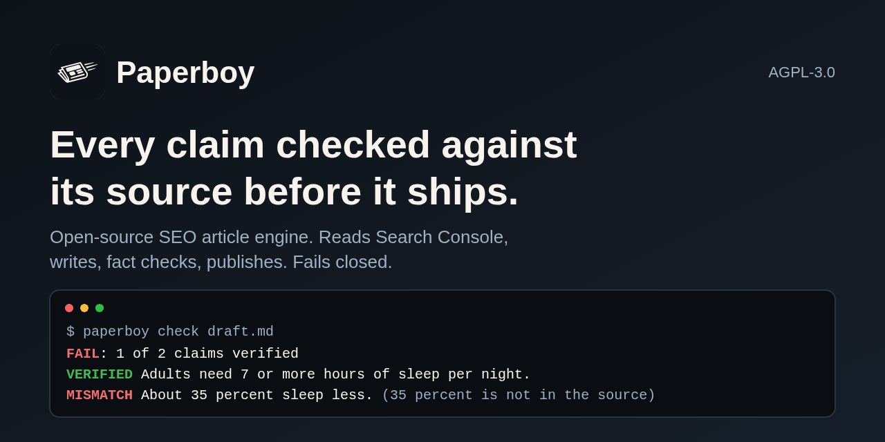
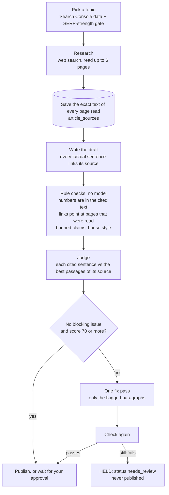

<div align="center">


# Paperboy

**The open-source SEO article engine that checks every claim against its source before it publishes, and holds the article if it cannot.**

[](LICENSE)
[](https://github.com/paperboyseo/paperboy/stargazers)


[Self-host in 60 seconds](#60-second-quickstart) · [How the fact check works](#how-the-fact-check-works) · [Use it from an AI agent (MCP)](#mcp-use-it-from-an-ai-agent) · [Paperboy Cloud](https://paperboyseo.com)

<br>



</div>

Paperboy reads your Google Search Console, picks a topic you can actually rank for, researches it on the live web, writes the article with Claude, and then does the step most AI writers skip: it compares the draft with the exact source text it saved while researching. Numbers that are not in the cited page, links to pages it never read, and claims the source does not support block the article. An article that still fails after one fix pass is held for a human and never published.

You bring your own Anthropic key and your own Postgres. It is one `docker compose up`.

## 60-second quickstart

You need Docker and an [Anthropic API key](https://console.anthropic.com).

```bash
git clone https://github.com/paperboyseo/paperboy.git && cd paperboy
cp .env.example .env        # set ANTHROPIC_API_KEY, PAPERBOY_ADMIN_EMAIL and PAPERBOY_ADMIN_PASSWORD; change the passwords
docker compose up --build   # Postgres, migrations, API server and worker on http://localhost:3000
```

On every start the `migrate` service applies any new database migrations, sets the app role's password and creates your operator account, then the API server and the worker come up. Check it with `curl http://localhost:3000/api/health`.

Drive it with the CLI. It is not published to npm, so run it from source (Node 22 or newer):

```bash
npm ci --prefix packages/cli && npm run build --prefix packages/cli
alias paperboy="node $PWD/packages/cli/dist/cli.js"

paperboy connect https://your-site.com --self-host http://localhost:3000
paperboy check https://your-site.com/some-article   # fact check any live page, no Anthropic key needed
paperboy topics                                      # what it would write next, and why
paperboy write --wait                                # research, write, fact check; then it waits for your OK, or is held if it fails
paperboy publish <article-id>                        # publish a passed article to the site's target
```

`connect` prints a URL and a code. Open the URL, enter the code and your `PAPERBOY_ADMIN_PASSWORD`. Nothing is spent on your Anthropic key until you run `paperboy write`: the worker's schedule is off (`PAPERBOY_ARTICLES_PER_WEEK=0`), and a passed article waits for your `publish`. Two steps in the [self-host guide](docs/self-host.md) turn it into a full loop: Search Console needs your own Google OAuth client, and publishing needs a target (WordPress, Ghost or a signed webhook) saved with one API call.

Prefer not to run anything? [Paperboy Cloud](https://paperboyseo.com) runs it for you.

## How the fact check works

This is the part that is different, so here is what the code does (`packages/engine/src/lib/quality`, `packages/engine/src/lib/engine/pipeline.ts`).



1. **The sources are saved, not remembered.** While researching, Paperboy reads up to 6 pages and stores the text of each one (up to 24,000 characters per page). Your own pricing or product page is saved the same way, so claims about your own offer are checked too. Every check below runs against those stored texts.
2. **Rule checks run first and need no model.** A number in a cited sentence must appear in the text of the page it links. A link must point at a page that was actually read. A source that sells something related must be disclosed. Banned claims and banned words are matched exactly. A shown calculation is checked through its inputs. Bare small integers and years are not treated as statistics.
3. **Then a judge reads each cited sentence next to the passages of its source that overlap it most** and answers `supported`, `partly_supported` or `not_supported`. With `ANTHROPIC_API_KEY` set the judge is Claude Haiku 4.5. With no key it falls back to `RuleJudge`, a deterministic word-overlap score that needs no model. The judge also flags unsourced specific claims, opinions stated as facts, and voice drift.
4. **The verdict is mechanical.** Six checks (every claim has a source, numbers match their sources, sources say what the article says, voice, banned claims, house style). Each blocking issue costs 12 points and each warning 2 (capped at 20). An article passes with zero blocking issues and a score of at least 70. Every issue carries the quoted sentence, the problem and the fix.
5. **Fail closed.** A failing article gets one fix pass on the flagged paragraphs, then the whole check runs again. If it still fails, the article goes to `needs_review` and is not published. The verdicts are saved per round, and if you disagree you can publish anyway through the API with `{"force": true}`.

What this does not do: it cannot tell whether a source is right, only whether the article says what the source says. The open `RuleJudge` is a baseline and will accept a paraphrase that overlaps the source's wording. The model judge is stronger; Paperboy Cloud runs a further-tuned verifier. Read [docs/fact-check.md](docs/fact-check.md) for the full method and how to plug in your own verifier.

You can run the check on anything, not only Paperboy articles:

```bash
paperboy check draft.md      # exit code 0 on pass, 1 on hold, so it works in CI
paperboy check https://example.com/blog/post
```

## Self-host or Cloud

| | Self-host (this repo) | [Paperboy Cloud](https://paperboyseo.com) |
|---|---|---|
| Who runs it | You | We do |
| Price | Free. You pay your own Anthropic bill. | Per site, per month. First article free, no card. See [pricing](https://paperboyseo.com/pricing). |
| Model key | Your Anthropic key | Included |
| Database | Your Postgres (bundled in Docker Compose) | Managed |
| The loop: topics, research, writing, fact check, publish, rank loop | Yes | Yes |
| Search Console | Yes, with your own Google OAuth client | One-click connect |
| Where articles go | WordPress, Ghost, signed webhook | Those, plus a hosted blog on your subdomain |
| Fact check | Open: rules plus Claude (your key) or `RuleJudge` | The tuned hosted verifier |
| CLI and REST API | Yes | Yes |
| MCP for AI agents | `paperboy mcp` over stdio | Remote server at `https://paperboyseo.com/mcp` |
| Dashboard | CLI and API | Web dashboard |
| Billing and plans | None | Yes |
| Cross-site learning | No | Yes |
| Support | GitHub issues | Email |

The loop is open under AGPL-3.0. The tuned verifier, cross-site learning and billing are not in this repository; the open code reaches the verifier only through the `Verifier` and `Judge` interfaces. Self-hosting for your own sites is free. If you modify Paperboy and offer it to other people as a service, the AGPL requires you to publish your changes.

## Configuration

Set these in `.env` (see [.env.example](.env.example)). Docker Compose also sets `DATABASE_URL`, `SERVER_DATABASE_URL` and `PAPERBOY_DB_SHIM` for you.

| Variable | Needed | Default | What it does |
|---|---|---|---|
| `ANTHROPIC_API_KEY` | To write | none | Research, writing and the model judge. Without it only `check` works, with `RuleJudge`. |
| `POSTGRES_PASSWORD` | Yes | none | Superuser password of the bundled Postgres. Used by the migration job. |
| `PAPERBOY_DB_PASSWORD` | Yes | none | Password of the `paperboy_server` role the app connects as. Set on every start. |
| `APP_SECRET` | Yes | none | At least 24 characters. Signs OAuth state and email links. |
| `PAPERBOY_ADMIN_EMAIL`, `PAPERBOY_ADMIN_PASSWORD` | Yes | none | The operator account, created on start. The password (8+ characters) approves CLI logins. |
| `NEXT_PUBLIC_APP_URL` | No | `http://localhost:3000` | Public URL, used in links and the Google redirect. |
| `PORT` | No | `3000` | API server port inside the container. |
| `GOOGLE_CLIENT_ID`, `GOOGLE_CLIENT_SECRET` | No | none | Your Google OAuth client, for Search Console. Scope: `webmasters.readonly`. |
| `RESEND_API_KEY`, `EMAIL_FROM` | No | none | Report and approval emails through Resend. Without a key emails are logged and skipped. |
| `PAPERBOY_ARTICLES_PER_WEEK` | No | `0` in `.env.example` | Articles per site per week that the worker starts on its own. `0` means only when you run `paperboy write`, so nothing is spent until you ask. Unset, the site's plan decides. |
| `PAPERBOY_DEFAULT_PLAN` | No | `starter` | Pace for new sites when the variable above is unset: `starter` 3, `growth` 7, `pro` 14 per week. |
| `PAPERBOY_APPROVAL_MODE` | No | `approve` | `approve`: an article that passes the fact check waits for `paperboy publish`. `autopilot`: it publishes by itself. |
| `PAPERBOY_PUBLISH_METHOD` | No | `hosted` | Default publish target for new sites: `wordpress`, `ghost`, `webhook`, `hosted`, `prompt`. |
| `SERPER_API_KEY` | No | none | A real Google top 10 for the SERP-strength gate. Without it a web search stands in. |
| `SERP_STRONG_RANK` | No | `100000` | A domain ranked this high in the Tranco list counts as strong. Lower is looser. |
| `PAPERBOY_VERIFIER`, `PAPERBOY_API_KEY`, `PAPERBOY_BASE_URL` | No | local | Set `PAPERBOY_VERIFIER=hosted` with a Cloud API key to use the hosted verifier. |
| `PAPERBOY_BRAND_NAME`, `PAPERBOY_OPERATOR`, `POSTAL_ADDRESS`, `NEXT_PUBLIC_SUPPORT_EMAIL` | No | Paperboy | Names and address that appear in emails. |
| `PAPERBOY_TRUST_PROXY` | No | off | Set to `1` behind a TLS-terminating proxy. |
| `PAPERBOY_DB_SSL` | No | on, except `localhost` and `db` | Set to `disable` to turn TLS off for another host. |
| `PAPERBOY_SEED_API_KEY_FILE` | No | none | Mint an API key at this path on start (mode 0600), for headless setups. |

Per-article cost caps (6 web searches, 1.50 USD, 600,000 tokens) are in `packages/engine/src/config/models.ts`. An article that would cross one is stopped and held. Read [docs/self-host.md](docs/self-host.md) before you turn on the schedule.

## MCP: use it from an AI agent

`paperboy mcp` runs a Model Context Protocol server over stdio, using the same key and base URL as the rest of the CLI (run `paperboy connect` once, or set `PAPERBOY_BASE_URL` and `PAPERBOY_API_KEY`).

```bash
# Claude Code
claude mcp add paperboy -- node /path/to/paperboy/packages/cli/dist/cli.js mcp
```

```json
{
  "mcpServers": {
    "paperboy": {
      "command": "node",
      "args": ["/path/to/paperboy/packages/cli/dist/cli.js", "mcp"],
      "env": { "PAPERBOY_BASE_URL": "http://localhost:3000", "PAPERBOY_API_KEY": "pb_live_..." }
    }
  }
}
```

| Tool | Effect |
|---|---|
| `list_sites`, `suggest_topics`, `get_job`, `get_article`, `get_performance` | Read only. |
| `fact_check` | Fact checks a URL or a Markdown draft. Fetches the pages it cites. |
| `write_article` | Starts an article and returns a job id. Spends money on your Anthropic key. |
| `publish_article` | Publishes an article. Makes content public. |

The two tools with side effects say so in their descriptions, so clients ask before calling them. `write_article` never asks the server to publish; whether an article goes live on its own follows the site's approval setting. Tool contract: [docs/mcp.md](docs/mcp.md). On Paperboy Cloud the same thing is a remote server, with a `pb_live_` key:

```bash
claude mcp add --transport http paperboy https://paperboyseo.com/mcp --header "Authorization: Bearer pb_live_..."
```

### Install in your coding agent

One line for the skill and the hosted MCP server in Claude Code, Cursor, Codex, OpenClaw and Hermes Agent:

```bash
npx skills add paperboyseo/paperboy
```

Per-agent steps, including the Claude Code plugin, are in [docs/agents.md](docs/agents.md).

## The CLI

Every command takes `--json` and works against Cloud or your own server (`--base-url`, or `connect --self-host`).

| Command | What it does |
|---|---|
| `paperboy connect [site-url]` | Sign in with the OAuth device flow, add your site, connect Search Console. |
| `paperboy topics [-n 5]` | What it would write next and why: query, position, impressions, SERP-gate result. |
| `paperboy write [--topic <id or text>] [--wait]` | Research, write, fact check. With no topic it picks one. |
| `paperboy check <url or file.md>` | Fact check a page or draft. Exit code 1 on hold. |
| `paperboy publish <article-id>` | Publish an approved article. |
| `paperboy status` | Account, site, publish target, Search Console state, latest articles. |
| `paperboy report [--days 28]` | Clicks, impressions and position. |
| `paperboy mcp` | The MCP server above. |

Exit codes: 0 ok, 1 fact check failed or nothing published, 2 error. Details and JSON shapes: [packages/cli/README.md](packages/cli/README.md). The REST API is in [docs/api.md](docs/api.md).

## What is in this repository

| Path | Contents |
|---|---|
| `packages/engine` | Topic selection and the SERP gate, research, writing, the fact check, publish adapters, Search Console sync, the rank loop, and the self-host API server and worker. |
| `packages/db` | Postgres migrations and the runner. A test applies all of them to a fresh database. |
| `packages/cli` | The `paperboy` command line tool and the MCP server. |
| `docs/` | Self-host guide, fact-check method, REST API, MCP. |
| `docker-compose.yml`, `Dockerfile` | One-command self-host. |

## Contributing

Issues and pull requests are welcome. Read [CONTRIBUTING.md](CONTRIBUTING.md) first: open an issue before a large change, claims in docs must be checkable, tests for behavior you change. Security reports go to security@paperboyseo.com, see [SECURITY.md](SECURITY.md). Everyone follows the [code of conduct](CODE_OF_CONDUCT.md). What is planned is in the [roadmap](ROADMAP.md).

If Paperboy saves you time, a star helps other people find it.

## License

[AGPL-3.0](LICENSE). Copyright Hive Asset Group, LLC. The name and logo are not licensed, see [NOTICE](NOTICE).
