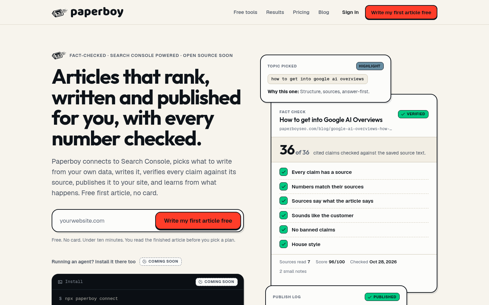

<div align="center">

<!-- Logo: the site icon from https://paperboyseo.com/icon.svg -->


# Paperboy

**Articles that rank, written and published for you, with every number checked.**

The open-source growth engine. It reads your Google Search Console, picks what to write, researches it, writes it, fact-checks every claim against its source, publishes it, and learns from what happens next.

[](LICENSE)


[Cloud: first article free, no card](https://paperboyseo.com) · [Docs](https://paperboyseo.com/docs) · [Self-host guide](docs/self-host.md) · [Roadmap](ROADMAP.md) · [Release notes](docs/releases/v0.1.0.md)

<br>

<!-- Screenshot of https://paperboyseo.com at 1440x900, captured 2026-10-29. Replace docs/assets/hero.png with a product shot any time. -->


</div>

> **Status: v0.1 alpha.** The engine, the fact check, the database, the self-host server, the Docker setup and the CLI are in this repository and tested. The MCP server and the agent plugins are **not** in this repository yet (the MCP server runs on the hosted cloud): see [Use with your agent](#use-with-your-agent) and the [roadmap](ROADMAP.md). The CLI is not on npm yet, so the quickstart runs it from source.

## Why Paperboy

- **Topics come from your own data.** It reads Search Console, finds queries where you already show up (page two, rising impressions), and checks whether the results page is beatable before it writes anything. `paperboy topics` shows what it would write and why.
- **Every claim is checked against its source.** Numbers must appear in the text of the page they cite. Links must point at pages that were actually read. A held article gets one rewrite, and if it still fails it is not published.
- **It closes the loop.** It publishes to WordPress, Ghost or a signed webhook, then measures the result and feeds it back into the next pick.
- **Open, scriptable, yours.** AGPL-3.0, one Docker Compose file, a REST API, and a CLI with a stable `--json` mode for scripts and agents. You bring your own Anthropic key and pay it directly, with hard cost caps per article.

## 60-second quickstart

You need Docker, Node 22 or newer, and an [Anthropic API key](https://console.anthropic.com).

```bash
git clone https://github.com/gleason24-sketch/paperboy.git
cd paperboy
cp .env.example .env        # set ANTHROPIC_API_KEY, the passwords, and PAPERBOY_ADMIN_EMAIL / PAPERBOY_ADMIN_PASSWORD
docker compose up --build   # Postgres + API server + worker, on http://localhost:3000
```

Then, in a second terminal:

```bash
npm ci --prefix packages/cli && npm run build --prefix packages/cli
alias paperboy="node $PWD/packages/cli/dist/cli.js"

paperboy connect https://your-site.com --self-host http://localhost:3000
paperboy topics             # what it would write next, and why
paperboy write --wait       # research, write, fact check, then publish or hold
```

`connect` prints a URL and a code. Open the URL, enter the code, and sign in with the admin email and password from your `.env`. Search Console needs your own Google OAuth client (`GOOGLE_CLIENT_ID` and `GOOGLE_CLIENT_SECRET` in `.env`, steps in [docs/self-host.md](docs/self-host.md)); without it, `paperboy check <url or file.md>` still fact-checks any page or draft.

Prefer not to run anything? The hosted version at [paperboyseo.com](https://paperboyseo.com) writes your first article free, no card.

## The CLI

`@paperboyseo/cli` installs a `paperboy` command (also `paperboy-seo`). Every command takes `--json` and works against the cloud or your own server (`--base-url`, or `connect --self-host`).

| Command | What it does |
|---|---|
| `paperboy connect [site-url]` | Log in with the OAuth device flow, add your site, connect Search Console. Flags: `--self-host <url>`, `--api-key <key>`, `--no-wait`, `--no-open`. |
| `paperboy topics [-n 5]` | Show what it would write next and why: the query, the position, the impressions, the SERP-gate result. |
| `paperboy write [--topic <id or text>] [--publish] [--wait]` | Research, write, fact check. Waits and prints the verdict. |
| `paperboy check <url or file.md> [--sources file]` | Fact check any URL or draft. Exit code 0 on pass, 1 on hold, so it works in CI. |
| `paperboy publish <article-id>` | Publish an approved article to the site's configured target. |
| `paperboy status` | Account, site, publishing target, Search Console state, latest articles. |
| `paperboy report [--days 28] [--markdown]` | Clicks, impressions and position, with a sparkline. |

Global flags: `--json`, `--site <id|domain>`, `--api-key`, `--base-url`, `--no-color`, `-y/--yes`, `-h`, `-v`. Exit codes: 0 ok, 1 fact check failed or nothing published, 2 error. Details and JSON shapes: [packages/cli/README.md](packages/cli/README.md).

## Self-host or cloud

|  | Self-host (this repo) | Cloud ([paperboyseo.com](https://paperboyseo.com)) |
|---|---|---|
| Price | Free. You pay your own Anthropic bill. | Per site, per month. See [pricing](https://paperboyseo.com/pricing). First article free, no card. |
| The loop (topics, research, writing, publish, rank loop) | Yes | Yes |
| Search Console sync | Yes, with your own Google OAuth client | Yes, one click |
| Fact check | Rule checks plus an open judge (rule-based, or Claude with your key) | The tuned hosted verifier |
| CLI and REST API | Yes | Yes |
| MCP server for agents | Not in this repo yet (use the CLI with `--json`) | Yes, at `https://paperboyseo.com/mcp` |
| Cross-site learning | No | Yes |
| Hosted blog on your subdomain | Not in this repo yet (needs the web app) | Included |
| Dashboard | CLI and API for now | Web dashboard |
| Support | Community, GitHub issues | Email |

**What is open and what is not.** The loop is open (AGPL-3.0). Three things stay closed because they cost money to run or to tune: the calibrated fact-check verifier (its prompts, passage selection and scoring weights), cross-site learning, and billing. The open code reaches the closed parts only through two small interfaces, so nothing here is crippled and nothing here is a fork. If you self-host, you get the baseline checker. If you use the cloud, you get the premium one. We say so plainly because "everything is open" would not be true.

AGPL in one line: self-hosting for your own sites is free. If you modify it and offer it to other people as a service, you must publish your changes.

## Use with your agent

**On the hosted cloud, today:** Paperboy runs a remote MCP server (Streamable HTTP) at `https://paperboyseo.com/mcp`, authenticated with your `pb_live_` API key. Its tools are `get_sites`, `suggest_topics`, `write_article`, `get_article`, `check_claims`, `publish_article`, `get_performance` and `get_queries`. `write_article` defaults to `publish: false`, so the agent asks before anything goes live. Setup for Claude Code, Cursor and Codex is in the [MCP docs](https://paperboyseo.com/docs/mcp); for Claude Code it is one line:

```bash
claude mcp add --transport http paperboy https://paperboyseo.com/mcp --header "Authorization: Bearer pb_live_..."
```

**In this repository:** there is no MCP server code yet. What is here is the REST API ([docs/api.md](docs/api.md)) and the CLI, which any agent can call today with `--json` against your own server or the cloud. The planned open MCP server (stdio first) is specified in [docs/mcp.md](docs/mcp.md) and tracked in the [roadmap](ROADMAP.md). Agent plugins (Claude Code, Cursor, Codex, OpenClaw) are not shipped yet either.

## How the fact check works

Nothing passes because it sounds right. Every article is checked against the exact text of the sources that were read while researching it.

1. **Rules first.** Every number in a cited sentence must appear in the source text it links. Links must point at sources that were actually read. Banned claims, banned words and house style are matched exactly. A shown calculation is checked through its inputs.
2. **Then a judge.** Each cited sentence is compared with the passages of its source most likely to support it. The judge answers `supported`, `partly supported` or `not supported`.
3. **A verdict.** Every check ends in **VERIFIED** or **HELD**, with the quoted sentence, the problem and the fix. A held article gets one rewrite from that list and is checked again. If it still fails, it is not published.

The judge is a plug: `RuleJudge` needs no model at all (it scores how much of a sentence's wording is in the source), `FastModelJudge` uses your own Anthropic key, and `HostedVerifier` makes one API call to the tuned verifier. Set `PAPERBOY_VERIFIER=hosted` and `PAPERBOY_API_KEY` to use it. More in [docs/fact-check.md](docs/fact-check.md).

## What is in this repository

| Path | Contents |
|---|---|
| `packages/engine` | Topic selection and the SERP-strength gate, research, writing, the fact check, publish adapters (WordPress, Ghost, webhook, plus the hosted-blog and paste-in-prompt adapters that need the web app), Search Console sync, the rank loop, and the self-host API server and worker. |
| `packages/db` | Postgres migrations and the runner. |
| `packages/cli` | The `paperboy` command line tool. |
| `docs/` | Self-host guide, fact-check method, REST API, MCP plan. |
| `docker-compose.yml`, `Dockerfile` | One-command self-host. |

## Cost control

Writing costs real money on your own key. The engine stops an article that would cross a cap (6 web searches, 1.50 USD and 600,000 tokens by default, in `packages/engine/src/config/models.ts`) and holds it for review. Read [docs/self-host.md](docs/self-host.md) before you turn on the schedule.

## Contributing

Issues and pull requests are welcome. Read [CONTRIBUTING.md](CONTRIBUTING.md) first (short rules: open an issue before a large change, checkable claims only, tests for behavior you change). Security reports go through [SECURITY.md](SECURITY.md). Everyone follows the [code of conduct](CODE_OF_CONDUCT.md). Running Paperboy on your own site? You can be listed in the [showcase](SHOWCASE.md).

## Star the repo

If Paperboy saves you time, star the repo. It is the cheapest way to help other people find it.

## Prefer it hosted?

[Write your first article free at paperboyseo.com](https://paperboyseo.com). No card, you read the finished article before you pick a plan. The cloud adds the tuned fact-check verifier, the web dashboard, the hosted blog and the MCP server.

## License

[AGPL-3.0](LICENSE). Copyright Hive Asset Group, LLC. The name and logo are not licensed: see [NOTICE](NOTICE).

Operated by Hive Asset Group, LLC.
