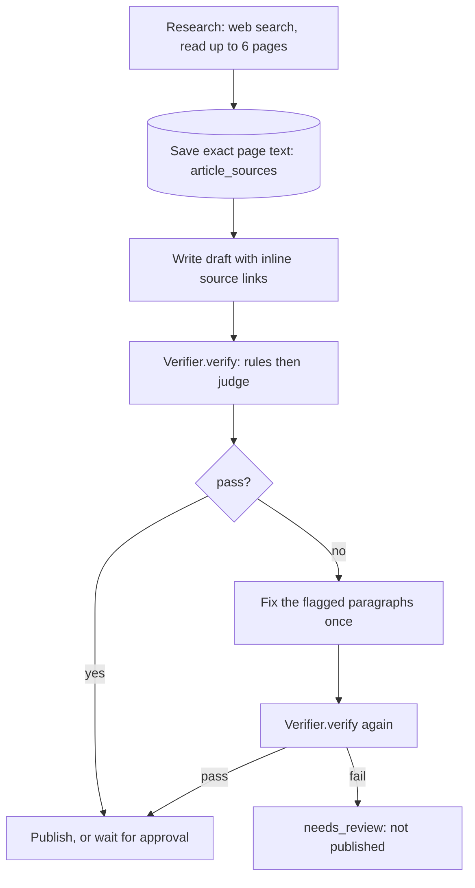

# How the fact check works

The goal: no claim in a published article that the engine could not check against a source it actually read. Nothing passes because it sounds right.

Code: `packages/engine/src/lib/quality/` (the check), `packages/engine/src/lib/engine/pipeline.ts` (where it runs), `packages/engine/src/server/factcheck.ts` (the REST endpoint).

## Where it runs



1. **Research** (`research.ts`). A web search finds candidate pages, up to 6 are opened, and the text of each is stored in `article_sources` (up to 24,000 characters per page, `LIMITS.sourceChars`). The customer's own home page and pricing or product pages are saved too, so claims about their own offer have something to be checked against.
2. **Write** (`write.ts`). The writer sees the saved sources and cites them with inline links.
3. **Check** (`pipeline.ts`, step 4). `getVerifier()` returns the verifier and the draft plus all saved sources go to it. The verdict of each round is stored in `quality_verdicts`.
4. **Fix once.** On a fail, `fixDraft` rewrites only the flagged paragraphs. If none of them can be located, the writer redoes the draft with `fixList()` as instructions. The check runs again.
5. **Hold.** A second fail sets the article to `needs_review` with reason `quality`, sends the review email and stops. It is never published automatically. Through the API you can still publish it with `{"force": true}`.

A pass then publishes, or waits for approval if the site's approval mode is `approve`.

## Inputs

`QualityInput` (`types.ts`): the article (title, Markdown body, FAQ), the saved source texts (URL and the exact text that was read), optional voice notes, banned claims, and the hosts that count as the customer's own site.

## Step 1: rule checks

Pure code, no model. `ruleChecks()` in `index.ts`.

- A number in a cited sentence must appear in the source it links (`45%` and `45 percent` match). If the sentence has no link, the link elsewhere in its paragraph counts, but only if that source contains the number.
- A number with no link must be a shown calculation, a labeled example, or a figure already verified elsewhere in the article.
- A link must point at a source that was read. A link to anything else, other than the customer's own site, is a block.
- A source flagged as selling something related must be disclosed near where it is cited.
- Banned claims and the customer's words to avoid are matched exactly. An em dash blocks. Hype phrases, a heading as the opening line, and a missing FAQ are warnings.
- Numbers that are not treated as statistics: bare integers of 12 or less, years, and unit constants such as 24, 52, 60, 100 and 365. These are not looked up in the source.

## Step 2: the judge

For each cited sentence the engine selects the source passages that overlap it most (`bestPassages`) and asks a `Judge` for `supported`, `partly_supported` or `not_supported`. In the same step the judge reads the whole article for unsourced specific claims, opinions stated as facts, banned claims in other words, voice, and whether the first paragraph answers the title.

| Judge | Needs | Notes |
|---|---|---|
| `RuleJudge` | nothing | Scores the share of the sentence's key words found in the passages: 60 percent or more is `supported`, 35 percent or more is `partly_supported`. Deterministic and free. It cannot judge voice or opinion, so it reports nothing there instead of guessing. It will accept a paraphrase that reuses the source's words. |
| `FastModelJudge` | `ANTHROPIC_API_KEY` | Claude Haiku 4.5 with generic prompts. This is the default whenever a key is set. |
| `HostedVerifier` | `PAPERBOY_VERIFIER=hosted`, `PAPERBOY_API_KEY` | One call to `POST /api/v1/verify` on a Paperboy server (default `https://paperboyseo.com`), which runs the tuned verifier. |

## Step 3: the verdict

`Verdict { pass, score, summary, judge, checks[] }`. There are six checks: every claim has a source, numbers match their sources, sources say what the article says, sounds like the customer, no banned claims, house style. A check passes unless it holds a `block` issue.

The score starts at 100 and loses 12 per blocking issue and 2 per warning (warnings cost at most 20 in total). The article passes with no block and a score of at least 70 (`PASS_SCORE`). The product language is **VERIFIED** and **HELD**. Every issue carries the quoted sentence, what is wrong, and the fix.

## Limits

- It checks the article against the saved sources. It cannot tell whether a source is correct.
- A page that could not be opened cannot support a claim. In `paperboy check`, claims that rest on it are reported `unsupported`.
- The open `RuleJudge` is a baseline. Use `ANTHROPIC_API_KEY` for the model judge.

## Checking something else

`POST /api/v1/fact-check` (and `paperboy check`, and the `fact_check` MCP tool) runs the same check on any URL or Markdown draft. It fetches every page the draft links to and uses the page text as the sources. Each claim comes back as `verified`, `held`, `unsupported` (no usable source) or `mismatch` (the source says something else).

## Plugging in your own

```ts
import { registerVerifier } from "@/lib/quality";
registerVerifier((budget) => ({ id: "mine", verify: async (input) => /* your Verdict */ }));
```

Register once at startup. The pipeline never knows which verifier it got. Order: a registered verifier, then the hosted one, then the local one.
